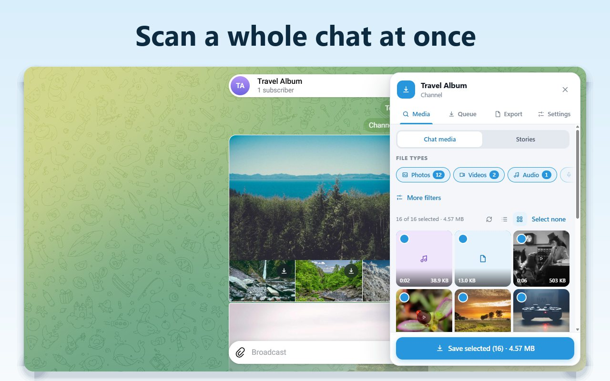
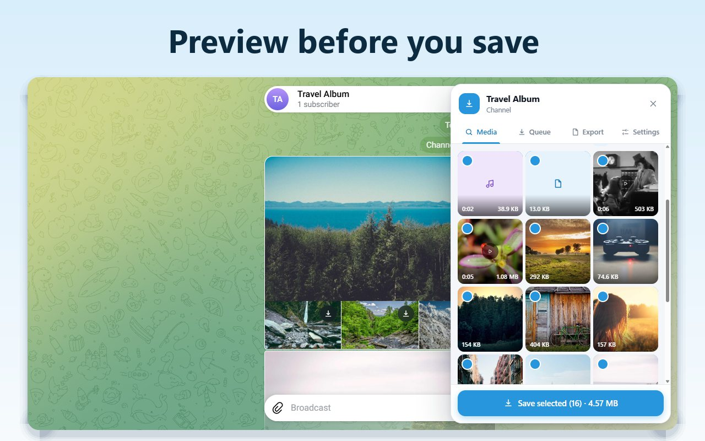
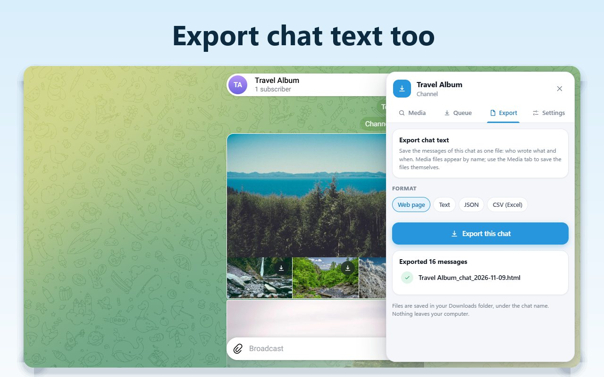
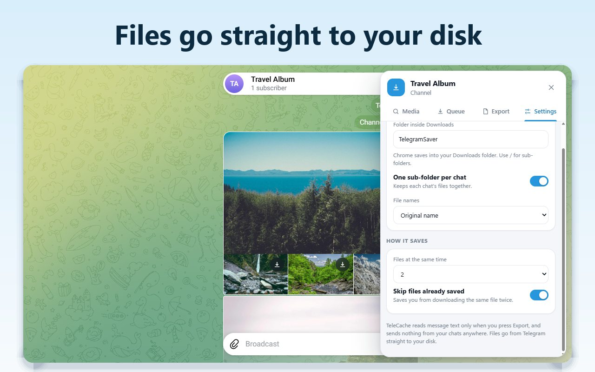

# TeleCache: Telegram Video & Media Downloader (Bulk Download from Telegram Web)

TeleCache is a Telegram video and media downloader that works inside Telegram Web. It scans the chat you have open, shows every photo, video, audio file and document with a preview, and saves the ones you choose straight to your disk, even files over a gigabyte, without asking for your Telegram password.

[Chrome Web Store](https://chromewebstore.google.com/detail/biifcociaekeoldlhlbpidmjaeodbhpl?utm_source=github&utm_medium=readme&utm_campaign=telecache) | [Full guide and FAQ](https://www.addonschrome.com/extensions/telecache-telegram-video-media-downloader.html?utm_source=github&utm_medium=readme&utm_campaign=telecache) | [Video demo](https://www.youtube.com/watch?v=0OpdDLFx_3s)

This repository is the public home for TeleCache documentation, release notes and the issue tracker. The extension itself is distributed through the Chrome Web Store.

## What it saves

Photos, videos, audio, voice messages, files, GIFs and round videos from a chat, channel or group, with a count for each type. Stickers are available as a filter. Stories of a contact or channel can be scanned the same way.

## Features

- **Scan a whole chat:** one press lists every media file in the chat you have open.
- **Preview before you save:** switch between a list and a grid, tick what you want and see the total size before you start.
- **Filters:** by file type, date range, minimum or maximum size, sender, or part of the file name.
- **Straight to disk:** files stream through Telegram's own download path to your drive, so a video of 1 GB or more never fills your computer's memory and arrives identical to the original.
- **A queue you control:** pause, resume, cancel one file or the whole batch, retry what failed, and choose how many files save at once. If Telegram reloads mid-batch, unfinished files wait for you to resume.
- **Organised folders:** each chat gets its own folder under Downloads. Keep original file names or use date-based names. Files you already saved are skipped.
- **Chat text export:** export the messages of a chat as a web page, plain text, JSON or CSV.
- **50+ languages.**

## How to use

1. Open Telegram Web K (web.telegram.org/k) and sign in. If you are on Web A, the panel offers a one-click switch to Web K.
2. Open a chat, channel or group and press Scan.
3. Filter by type, date, size or sender and untick what you do not need.
4. Press Save. The queue saves each file into a folder named after the chat, with progress for each one.

## Pricing

TeleCache is free to install from the Chrome Web Store.

## Privacy

TeleCache never asks for your Telegram password or phone number. It works inside the Telegram Web session you already have open, and your chats are never sent to our servers. Lists, previews, the queue and exports stay on your device.

## Responsible use

Chats where the owner restricted saving and forwarding are respected: nothing in them is listed, saved or exported. Use TeleCache for your own material and content you have the right to keep.

## Screenshots

## Support

Found a bug or have a feature request? [Open an issue](../../issues).

## Disclaimer

TeleCache is an independent extension and is not affiliated with, endorsed by or sponsored by Telegram. Telegram is a trademark of its respective owner.

Built and maintained by [Addons Chrome](https://www.addonschrome.com/?utm_source=github&utm_medium=readme&utm_campaign=telecache).
